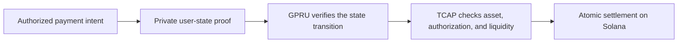

For a balance-changing action, GPRU is intended to guard the integrity and privacy of the user's private state presented to TCAP. Its proof should establish that the hidden state is current and that the proposed transition follows from it. TCAP governs accepted assets, authorization, and liquidity, then applies a valid change atomically.

The proof does not make GPRU a custodian and does not replace TCAP's settlement checks. Encrypted Memo records can preserve transaction details for the owner to recover, while the on-chain proof and authorization establish whether a state transition is valid.

## Availability and limits

The hidden-head proof flow is not established as an end-to-end settlement capability. Do not represent confidential credit, debit, or exit as available based only on a source file, SDK helper, or transaction submission. Confirm the applicable transaction on the target cluster.

Each TIN settlement is designed as a new opaque record without a public pointer back to the funding transaction or private predecessor. The owner retains that lineage; TSNP/TCAP verify the proof without learning the hidden TIN link. Funding reveals its sender, amount, and protocol destination, but not the hidden TIN recipient. Shared roots and timing do not establish a recipient link. Wallet-to-wallet transfers expose their endpoints. A TIN debit to wallet exit exposes the output wallet and amount but not the source TIN; later output-wallet activity remains public. The hidden-head proof path remains fail-closed, so this design is not yet verified end to end as a runtime guarantee.

The proof statement, Memo format, verifier, and service integration are documented in the [repository's GPRU and TCAP technical notes](https://github.com/bigdreamsweb3/trustlink-pay/tree/main/docs).
